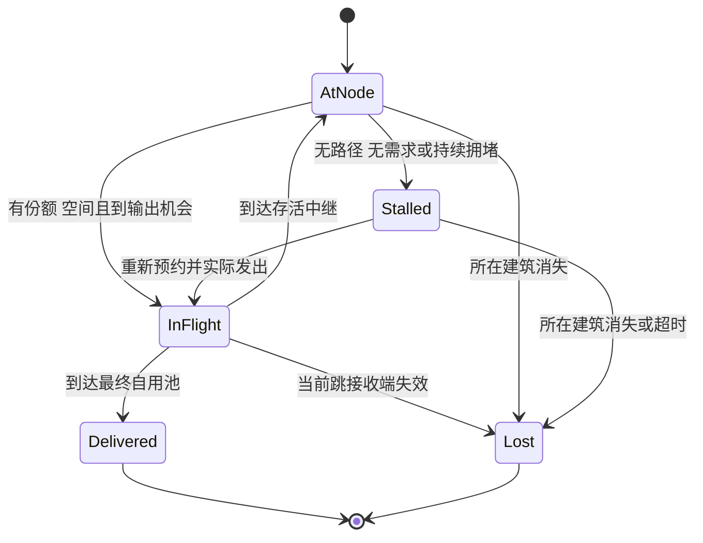

# 涌现防线能源网络工程设计

日期：2026-10-10。状态：第二阶段已接入战斗并完成本轮能源改进；用户实际运行后关闭程序并确认验证完成，本轮验收结束。玩法约束来源于讨论；具体算法、默认参数和同一步内的结算边界是公开的工程选择。总架构见 `EngineeringDesign.md`，第一阶段接口记录见 `WhiteboxDevelopmentContract.md`；历史证据见 `Docs/Validation/PhaseOneWhiteboxReport.md`，本轮最终证据见 [PhaseTwoWhiteboxReport.md](../Validation/PhaseTwoWhiteboxReport.md)。

能源网络采用“按有效量加权调度、自动规划路线、按批次运输、保留访问历史、累计滞留超时”。网络允许拓扑有环和不同批次相向运输；禁止的是同一批能量再次进入已经访问过的建筑。波次变化不改变能源世界的生命周期。

第三阶段沿用上述结算规则，增加只读 `SupplyAssessment`、每完整模拟秒实际到货统计，以及 UI 预约与到货分列。诊断读取现有拓扑和中继滞留，不修改批次、预约或调度。新增重击炮、范围炮仍是普通终端消费者。具体玩家提示的定义及估算限制见 `PhaseThreeGameplay.md`。

## 不变量

1. 每份实际能量在任意时刻只有一个所有者：源头缓存、中继缓存、在途批次、最终自用池之一。
2. 预约表示未来空间和供给承诺，不能加入实际能量总量。
3. 终端满足 `当前储量 + 已承诺有效到货 <= 容量`；中继满足 `当前储量 + 已预约下一跳到货 <= 容量`。
4. 同一批能量的访问历史单调增加，拆分继承，改道/换目标/修复/移动不清空。
5. 每次发送扣源存量、记损耗、创建在途所有权、登记到货事件，作为一个事务提交。
6. 到货、取消、超时和销毁各自至多结算一次。重复、过时事件只能被忽略，不能重复加电或退预约。
7. 成功进入终端自用池后，运输完成；自用储能不再路由，不受运输滞留超时影响。
8. 任何零损耗边、即时到货设置都不能触发递归无限转发；每一跳至少占用一个逻辑 Tick。

开发版每 Tick 或采样执行容量与守恒断言，失败输出批次 ID、事务 ID、Tick、前后余额。正式版也不能用强行 clamp 储量来掩盖重复结算。

## 数据模型

| 数据 | 核心字段 | 所有者与用途 |
| --- | --- | --- |
| `BuildingId` | 会话内不复用的 64 位 ID | 同一拥有建筑在移动、维修后仍保持身份；新购买建筑使用新 ID；第二阶段没有波末自动恢复 |
| `EndpointToken` | BuildingId、LifeGeneration、PositionRevision | 识别到货接收实例和位置；从已毁状态恢复时代次增加，普通修补 HP 不变；正式移动后位置版本增加 |
| `EnergyNode` | 职责、逻辑端口、收发范围、容量、存量、输出节拍 | 与 GameObject 无关；核心是终端，反应堆是源头 |
| `ConsumerDemand` | 容量、当前自用储量、有效到货预约、权重、剩余需求 | 一个终端只出现一次，不能因多条路线或多个源头重复计算权重 |
| `EnergyBatch` | BatchId、当前量、状态、所在节点/当前跳、目标、路线游标、HistoryHandle、剩余滞留 Tick | 一个批次可代表多点能量；不是每点能量一个对象 |
| `RoutePlan` | 不可变节点序列、边效率、端点版本、创建时拓扑版本 | 活动批次可共享计划；失效时更换剩余路线，不修改其他批次的共享数组 |
| `EnergyHistory` | 建筑 ID、不可变父记录 | 表示实际访问历史，允许拆分批次共享前缀；当前复用 .NET 垃圾回收，不自建引用计数池 |
| `DeliveryCommitment` | 任务 ID、目标、预计有效到货、已预支调度份额、状态 | 防止重复供给，支持按批次取消/分拆/改目标与到货核销 |
| `HopReservation` | 当前跳 ID、接收端令牌、预计本跳到货量、状态 | 保证物理空间；最后一跳复用终端承诺的空间，不再次加一份预约 |
| 到货集合 | 到达 Tick、批次 ID、接收端生命代次与位置版本 | 使用 .NET SortedSet 有序集合；取消时移除事件，不积压无效记录 |
| `EnergyLedger` | 实际产生、各处存量、实际消耗、分原因损失 | 独立核对资金式账目，不依赖视图 |

源头尚未发出的库存可作为一个数值池；第一次进入运输时建立包含源头 ID 的历史。中继运输缓存必须保存批次，不能合成一个丢失历史的数值。终端自用池可以合并数值，因为后续只消费、不转发。

历史记录使用不可变共享链，查询时沿链建立可复用的禁止访问集合，再运行受约束寻路。第二阶段让源头及相同实际访问前缀复用同一个不可变对象；复用索引最多 4096 项，淘汰只删除索引，不修改仍被批次引用的历史。当前不使用可复用的历史句柄池，历史对象生命周期由实际引用和 .NET 垃圾回收管理。

只记录实际到达的建筑；计划中尚未走到的节点不是已访问节点。当前所在节点作为寻路起点允许出现一次，禁止再次作为后续节点进入。已失效建筑的历史也保留：以后修复的相同 BuildingId 仍应被排除。

会话持续允许新建建筑，历史长度不能用“当前最多 100 栋未出售建筑”证明永远有界；新购买建筑会得到新的身份。需要持续记录历史和批次数量，不能清空旧历史继续发送。正式容量和回压策略仍需长局、反复建造/出售压力测试确定，4096 项复用索引上限不是实际历史长度上限。

## 数量精度与能量守恒

工程初值：`EnergyAmount` 为 `long`，1000 个最小单位表示 1 点能量；效率用百万分比整数，范围 `0..1_000_000`。Inspector 输入常规小数，内容编译阶段量化为整数，超出精度时显示说明。

单跳结算：

```text
received = floor(sent × efficiencyPpm / 1_000_000)
loss = sent − received
```

量化尾差已经包含在 `loss`，不能再额外扣一次“舍入损耗”。校验 `sent` 和乘积不会溢出，初版限制单次数量不超过 `long.MaxValue / 1_000_000`；容量、产量、份额累积同样检查范围。路径规划用浮点代价不改变整数权威账目。

多跳预计到货按每一跳顺序取整，不能只把累计效率乘一次后取整。反推源头所需量时按每跳效率倒序向上取整，并再次正向验证。有效到货为零的微小发送不应占据大量运输事件：先在源头/原中继累积到可产生有效到货的批量，或判断该需求在当前资源下不可满足。

守恒式：

```text
初始实际能量 + 累计实际发电
= 源头库存 + 中继库存 + 在途库存 + 终端自用库存
  + 累计实际消耗
  + 传输损耗 + 建筑消失损耗 + 当前跳失败损耗 + 滞留超时损耗
```

发电机缓存满时采用回压：本 Tick 只计入真正存入缓存的产出，未产生的潜在产能单独统计，不制造无限待发批次。该选择需在 UI 区分“可发电能力”和“实际产生”，源头缓存容量为可编辑配置。

## 连接图与低损耗路径

建筑逻辑端口位置来自格子位置与定义内端口偏移，不从动画 Transform 读取。首版距离采用端口间欧氏距离（格子单位），属于工程初值；多格建筑的中心/端口约定需在编辑器 Gizmo 中可视化。

有向边 `u → v` 需要：u 能输出、v 能输入、两者存活、满足传输范围；源头不能作为接收中继，终端不能作为过路节点。连线不做建筑遮挡或 NavMesh 判定。邻域通过格子空间索引查询，不在每帧全量两两扫描。

当前距离损耗由配置中的最大射程损耗确定：`保留率 = 1 − MaximumLossAtRange × (distance / range)²`，随后量化为边效率。自定义曲线/表仍是可扩展方向，并非已有编辑功能。早期示例在距离 1..3 的保留率 `1 − (d−1)^2/8` 不作为当前实现或最终平衡数值。

对边保留率 `eta`，规划代价使用：

```text
cost(edge) = −ln(eta)
cost(path) = Σ cost(edge) = −ln(Π eta)
```

因此在正保留率范围内，最小代价对应最大保留率；`eta = 0` 的边不参与有效供给寻路。普通 Dijkstra 要求非负边权，适用于此转换；使用二叉堆时一次查询按 `O((V + E) log V)` 估计。[MIT Dijkstra 课程](https://ocw.mit.edu/courses/6-006-introduction-to-algorithms-spring-2020/resources/lecture-13-dijkstra/index.html)。

这是连续效率模型的低损耗排序；对极小批次，逐跳整数取整可能使候选路线的实际结果相同或排序有细微差别。发送前按真实批量计算有效量；原型需验证量化误差不影响玩家可感知的路线选择，不能宣称浮点最短路证明了所有离散批量的精确最优。

同等损耗时依次比较较短预计传输时间、较少跳数、稳定建筑 ID。出队已确定的节点不再次展开，父指针构成简单路径；即使存在零代价环，也不把环放进路线。旧批次寻路时禁止其历史节点，所以跨多次重规划仍不能回流。

主路线受阻时，在临时过滤当前阻塞输出资源/接收空间的图上寻找低损耗备用路线。正常输出冷却不直接当成故障。过滤只影响这次可用性查询，不永久删除几何边；无备用路线则等待。后方拥堵信息是当前快照，不是未来容量保证，真正发射仍需逐跳预约。

这种方法不保证枚举全部备选路径或求全网最优流。若压力测试发现局部过滤过于保守而长期漏用可行通路，再针对反例改算法并更新设计，不在首版隐式叠加一个全网求解器。

当前实现按目标建立反向 Dijkstra 路径树，让多个供应节点共享同一次搜索。只复用已确定最短距离的节点路径；其余部分可以跨逻辑步继续计算。旧批次复用前检查访问历史和未完成后缀，历史不兼容时做前向受约束 A* 查询。仅完整完成的无约束路径树可提供损耗、行程和跳数下界，未完成树不作为启发函数。几何树按拓扑版本失效，拥堵树使用独立可用性快照，优先级变化不重建几何图。新建的低损耗捷径可供新任务选择，现有合法在途批次无需全部掉头。

第二阶段搜索候选改用标准二叉最小堆。历史查询完成后将结果保存为独立边数组，临时搜索集合清空并复用，最多保留 64 份空闲工作集合；在途路线不能引用已清空的查询集合。动态受约束查询替换旧版本时，同时移除旧的缓存年龄记录；受约束查询缓存上限保持 2048。

供应候选及已确定基础路线跨 Tick 缓存，不在每 Tick 为每个目标重新扫描全体建筑。成交前重新检查动态库存、出口额度和物理接收空间；报价尚未全部准备完成时，已确定的可用候选可以先供能。历史专用搜索在没有实际停留批次继续持有其历史时取消；通用避堵查询在目标失效或已无缺口时取消，不用较短的“最近请求时间”误杀仍在正常轮询的工作。

几何拓扑变化当前仍重建全图并清理相关路线缓存，尚未完成节点/边到活动任务的全套局部失效索引。第二阶段已经局部化的是可用状态更新：每步采集中继可用容量，实际发送时只刷新发送与接收两端，避免每次动态报价扫描全图。已走完的前缀只用于历史，前缀建筑后来死亡或移动不使已合法出发的能量倒流或消失。

## 需求与预约

每个终端的有效需求：

```text
need = max(0, capacity − stored − committedEffectiveIncoming)
```

`committedEffectiveIncoming` 包括已经分配、仍在源头排队、在中继等待以及正在飞行的可交付任务；只要承诺有效就计入，不能只数飞行粒子。同一任务在多个中继移动时不重复登记需求。

终端预约和中继物理预约分别管理：

- `DeliveryCommitment` 在分配目标时建立，扣减终端可用缺口。
- `HopReservation` 只在当前跳真正准备出发时建立，预约接收方本跳损耗后的量。
- 若接收方就是终端，当前跳的空间由对应 DeliveryCommitment 保证；HopReservation 引用它，不再次把同一份能量加进终端预约总数。
- 后续中继空间不一次性全部预约，避免整条长路线长期占死网络；代价是途中可能排队。

当原承诺失效或批次进入故障/持续拥堵滞留时，释放该批次尚未交付的终端承诺，并结清未兑现的调度预支。仍有效的当前跳物理预约保留到该跳结束，以免接收空间被其他批次抢占。批次完成当前跳或恢复发送前再申请目标额度。

新路线的损耗发生变化时重新计算预计有效到货，原子更新预约；新目标空间不足时可拆分运输份额，剩余仍在原节点。实际尚存的能量不会因取消承诺而返还源头或复制。

吞吐或份额限制导致拆分时，也必须按各子批次的真实数量重新做后缀逐跳取整。以子承诺之和替换母承诺，差额释放空间并结清服务额度；不能假设拆分前后预计到货一定相等。最后一片完成或损失后，母任务不得留有无法核销的残余预约。

例：终端容量 100、存量 60、备用路线已承诺 40，则原路线恢复后留在 A 的 20 点旧能量不能直接补进该终端；它需转供其他目标或等待新的缺口。

## 加权分配与发送调度

### 接收量计费的加权 DRR

实现采用加权 Deficit Round Robin 的服务额度思路，中文称为加权额度轮询：为已经参与调度的终端维护份额余额，单轮额度为 `baseQuantum × weight`，按预计最终收到的有效量扣除。余额和轮询游标跨逻辑步保留；当前优先级档位为 1/2/4，高优先级更多、其他可服务建筑仍有份额。

第二阶段修正了长期竞争时的尾数偏差：发生实际服务后，推进下一轮时对所有已登记且存活的终端统一增加各自权重额度，并保留未用余额，最多两轮。没有服务进展时不累加，只恢复已经耗尽的额度；撤销承诺退回的额度也最多两轮。修改优先级时，将旧余额限制在新权重的一轮额度内。这些余额不是实际能量，不能计入守恒总量。

DRR 的原始研究讨论变长分组的公平队列；本文把计费单位改成最终有效能量，并加入供需、路由和预约约束。原论文的逐包复杂度结论不能直接套用于整个游戏网络。[DRR 原始技术报告](https://repository.library.washu.edu/cse_research/339/)。

一次受预算约束的分配访问：

```text
轮到目标 i
  若已满或没有有效需求：跳过，不为该目标安排新供给
  使用当前轮次中该目标已有的受限额度
  在可提供真实库存的源头/未分配旧批次中寻找合法路线
  优先采用低损耗可行报价，拥堵时尝试备用报价
  将金额限制在：需求、份额余额、可用库存、批量上限和当前可发能力内
  原子提交目标承诺；预支对应有效量份额；把实际库存标记为该任务所有
  没有可行发送时保留受限份额并跳过，让其他可行目标继续
需要进入下一轮时
  本轮有真实服务进展：各存活账户增加各自权重额度，余额最多两轮
  本轮没有进展：不累加，只恢复已耗尽账户的一轮额度
```

多源的同一库存不可同时报价成交：最终提交时校验库存版本并锁定分配份额。旧批次只能用它当前位置和历史允许的资源参加调度。每轮完整跳过所有不可行目标且没有进展时立即退出，等待新的资源/拓扑事件，不能无限空转。

预计交付额度是预支，最终到货才计入 `DeliveredEffective`。成功交付按实际量核销；未交付、改目标或超时只退回未兑现的调度额度一次，绝不退回已经消耗的发电能量。每个任务记录结算状态，限制补偿余额上限，防止不断取消任务囤积服务信用。

权重改变后使用新权重增加后续额度，旧余额立即裁剪至新权重的一轮额度；不能把历史无限积分带入后续竞争。已经开始的一跳继续执行，尚未开始的发送及之后中继的选择按新优先级调度。当前面板显示已安排的有效供给，长期有效到货率由测试与诊断报告核对，不能把预约量当作实际到货率。

### 中继共享吞吐

每个中继在一个输出机会可发送的总量不超过 `OutputAmount`，下个正常机会由 `OutputIntervalTicks` 决定；可以把一次输出量拆给多个下一跳，未用额度不无限积累。这里计量的是中继实际发出的量，损耗在发送后计算。

同一中继的各终端队列按权重做局部 DRR，局部额度同样按这些批次预计最终交付的量比较；物理限制仍扣真实本跳发送量。全局目标份额只在任务分配时预支一次，不能在每个中继重复扣全局额度。局部 DRR 是共享输出机会的仲裁，不是再次产生一份能量或一份全局供给承诺。

不能因为某个批次等待空间，就把同队列后所有具有其他合法下一跳的批次一起堵住。检查工作有预算并保存游标；同一节点一次机会只花费一份总输出量，多个出口不是每个都得到完整 OutputAmount。

### 公平性的范围和检验

在共享同一供给、持续有需求、通路可行、没有额外瓶颈和损失的例子中，70 点供给、权重 4:2:1、各需求 40，目标分配为 40/20/10；若高优先级只缺 10，则为 10/40/20。长期比例允许批量和到达延迟造成的短时误差，但不能让低优先级长期为零。

按有效量公平会使远端消耗更多源头能量。两目标权重相同、需求充足、保留率分别为 1 和 0.5，共享 30 点源头供给时，理想结果为各收到 10，分别使用 10 和 20 点源头能量。

多源、多瓶颈、多条路线下，按路径可行性分配和逐节点仲裁不等于精确的全网加权最大最小公平；独立供电区域不互相分走并不存在的电量。工程验收必须测实际到货、需求上限、路径利用率和低优先级服务，不能只看分配器预支了多少额度。若这些可观察行为不能满足已确认玩法，阶段 3 不能通过，需改进分配器。

第二阶段独立 .NET 长期检查使用 36000 个逻辑步，保留原有 5% 误差与 80% 吞吐下限。共享中继、不同损耗、相同权重场景修复后的两端有效到货为 35282067 与 35282443；共同源头和共同中继的 4:2:1 用例也保持长期份额。原始记录及旧版偏差见 `Tools/Performance/README.md`。这属于纯模拟证据，不覆盖所有动态图，也不代表真实 30 分钟 Player 已经通过。

## 批次状态与累计滞留



`AtNode` 可细分 Ready、正常等待输出、分配/寻路待处理；这些是数据状态，不是每个批次一个 MonoBehaviour。

| 情况 | 计入累计滞留 | 说明 |
| --- | --- | --- |
| 合法飞行 | 否 | 出发到到达由 ArrivalEvent 推进 |
| 刚到中继，等待它下一次正常输出机会 | 否 | 正常 OutputInterval 不当成故障 |
| 无合法路径、没有可重新分配的有效目标 | 是 | 空间/线路/需求变化可唤醒 |
| 到了可以输出的机会，因下游满、份额竞争或容量限制未能发出 | 是 | 从错失发送机会起标记持续拥堵 |
| 持续拥堵期间又进入下个输出周期 | 是 | 不能每个周期只计一个 Tick，否则大间隔中继几乎不会超时 |
| 算出新路线，但还没真正出发 | 已滞留的继续计时 | 重算、换目标和刷新预约不算运输进展 |
| 部分批次发出 | 发出的部分暂停，留存部分继续 | 拆分双方继承拆分前剩余预算 |
| 已存入终端自用池 | 不再适用 | 消費和储存均不属于运输等待 |
| 玩家暂停游戏 | 否 | 模拟时间不推进 |

计时记录累计滞留 Tick、进入状态的 Tick 和当前是否持续滞留，先结算已经过去的时间区间，再尝试恢复运输。当前白盒实现集中遍历活动批次，不给每个批次挂协程或 MonoBehaviour；独立到期事件队列留作有测量依据后的优化。

输出拥堵与能源模块自身“这一帧寻路预算没跑完”要区分。后者是工程过载，需要排队和监测，不能冒充无路、消耗玩家的故障预算或丢失能量。重规划队列按最早待处理时间公平轮转，记录等待时长；过载长期存在就是性能验收失败。

首版不再添加独立的总运输寿命。累计滞留规则不会给一直正常前进的批次规定总年龄上限；历史增长和动态新建必须由规模测试覆盖，不能把本机制称作 RTT，也不能声称它等同 IP 跳数限制。[TCP RTT 与 RTO](https://www.rfc-editor.org/rfc/rfc6298.html)、[IPv6 Hop Limit](https://www.rfc-editor.org/rfc/rfc8200.html#section-3)。

## 建筑变化与当前跳结算

| 变化 | 处理 |
| --- | --- |
| 原最终目标失效，但批次在存活 A 中 | 释放原承诺，从 A 按权重重新选目标并寻路；无路则滞留 |
| 后方路线失效，当前一跳接收节点仍有效 | 保留这跳和物理预约，到达后再分配；释放已不可靠的终端承诺 |
| 当前一跳接收节点被毁/出售 | 立即取消到货，在途实际量记损失；释放预约；后续旧事件忽略 |
| 当前一跳接收节点正式移动 | PositionRevision 改变，旧位置到货失效，按当前跳失败结算 |
| 发送节点在发出之后被毁/出售/移动 | 已经出发的有效当前跳继续；该节点尚未发出的库存按生命周期处理 |
| 持有能量的中继被毁/出售 | 其中所有实际库存损失，取消关联任务；没有临时幽灵中继 |
| 持有能量的建筑移动 | 库存随建筑保留，ID/历史不变；从新位置检查未发送任务，输出节拍与滞留预算不重置 |
| 建筑修复/恢复 | 拥有 ID 保持；从已毁状态恢复才增加生命代次，存活建筑普通修补 HP 不增加代次；新连接可用，但旧失效到货不复活、被损失库存不返还 |
| 原路径重新可用 | 唤醒相关等待批次，重新取得目标额度；已走备用路线的合法在途批次继续 |
| 终端自用池所属建筑消失 | 自用存量记损失，不能回流到其他终端 |

新购买建筑即使位于原格子，也使用新 ID，不能接收发给旧建筑的迟到事件。真实移动仅在合法放置命令提交时发生；鼠标拖动的预览不会每帧改图，也不会让批次不断失效。

第二阶段已通过同一 `GameWorld` 接入炮塔、敌人和波次。炮塔先从自用池全额扣能才即时伤害敌人，缺能等待且不积累补射；核心先耗能吸收伤害，再减少耐久。波末只发一次资金奖励，不自动修复、恢复耐久或补能；下一波保持同一个能源实例。重新开始才创建新世界、恢复场景初始布局与空缓存。

换目标必须先取消原任务未交付部分的承诺/服务预支，再以新目标额度重新成交。原目标仍有需求、仍可达时可以继续服务，但不能凭“旧任务”永久压过其他目标的权重。

## 资源等待环

没有能量回流，不代表不会发生容量等待环。例如 A 已满且其中批次下一步想去 B，B 也已满且其中另一批次想去 A；两条各自合法的路线仍可能相互等待。

首版不做无空间条件下的免费交换或同时瞬移。先寻找备用出口/新目标，不能走时按持续拥堵累计，最终由超时损失释放空间。这是已确认拥堵与损失规则的结果。需要专门测试和统计这种情况；如果经常出现并损害玩法，再讨论提前预留通路/时间槽等更复杂方案。

## 性能与工作预算

权威能源数据集中存储；GameObject、粒子数与逻辑批次数分离。路径树、访问历史、有序到货集合和队列共享或复用已有数据。拆分只在吞吐、目标缺口或份额确实需要时发生，不能按“每 1 点”固定拆成对象。

兼容的未发送批次可合并，但必须一致：所在节点、历史、目标/路线、滞留状态和预算、节拍约束。已有预约或已计价的批次不能简单相加后覆盖；需要保留可核销的子任务记录，重算取整与预约也必须守恒。表现聚合始终不要求逻辑合并。

以 V 为建筑数、E 为连线数、P 为活动批次数、H 为一次查询的历史长度：

- 建筑变化触发几何图重建，候选边通过空间桶查询，不在每个渲染帧扫描所有建筑对；局部范围很大时 E 本身仍可能接近 V²，必须把实际 E 纳入压力场景。此处不能误写成只重建受影响的局部拓扑。
- 一次受约束寻路约为 O(H + (V + E) log V)，缓存命中可少做搜索，但仍需校验后缀和历史。
- 到货集合插入、移除约 O(log P)，只处理到期到货；当前滞留计时和快照更新仍需 O(P) 批次遍历。
- 调度工作与活跃目标、可用批次、成交/失败检查次数相关，设确定性的每 Tick 次数预算和跨 Tick 游标；禁止宣称整个系统 O(1)。

同一步内的命令和战斗先完成建筑变更，随后能源系统统一检查版本并刷新连接图。没有几何变化时复用图；拥堵使用独立可用性版本和查询缓存。断路大量出现时保留有界工作预算与待处理队列，记录恢复延迟；更细的拓扑失效范围仍是后续优化项。

批次、历史、路线缓存、候选报价和事件堆分别记录数量、峰值、命中/失效率。工程容量不足时回压新批次分配和生产，既不删除旧历史，也不悄悄创建越界缓存；要输出明确诊断，并在阶段验收中解决。

## 验证矩阵

以下是长期验收矩阵。第一阶段历史证据保留；第二阶段已经实现波次模块，相关规则与边界进入 Unity 行为测试，本次文档更新时总计 69/69 通过。独立 Player 流程、可见画面及规模性能的最终状态见第二阶段报告，不能由规则测试通过推定长局和性能也通过。

| 编号 | 场景 | 验收重点 |
| --- | --- | --- |
| T01 | 无损单跳和多跳传输 | 守恒、延迟、没有同 Tick 连续穿透多节点 |
| T02 | 连续损耗、极小数量、已预约批次再次拆分 | 逐跳取整、无能量增长、子承诺替换母承诺后无残余占用 |
| T03 | A→B→A 和 A→B→C→A | 拒绝历史节点；TTL 不是防环依据 |
| T04 | 改道、换目标、拆分、节点修复 | 历史及预算继承；计划节点不被误当已访问 |
| T05 | 70 点、4:2:1、各需求 40 | 共同瓶颈可行场景接近 40/20/10，报告批量误差 |
| T06 | 高优先级只缺 10 | 重新分配后接近 10/40/20，不为已满建筑囤份额 |
| T07 | 相同权重、效率 1 与 0.5、源头 30 | 有效量接近 10/10，源头支出 10/20 |
| T08 | 多源供同一炮塔、多路径预约 | 终端需求只计一次，存量与承诺不超容量 |
| T09 | 目标不可达、独立供电岛、共享瓶颈 | 不可达目标不阻塞可行目标；不跨岛分配虚拟供给 |
| T10 | 最低损耗路径堵塞、备用路径恢复 | 可以选择高损耗备用；恢复后不让合法在途批次反复掉头 |
| T11 | 断路期间新路补满、旧路恢复 | 旧批次重新预约或转供，不造成重复到货 |
| T12 | 故障 4 秒、运输恢复、再故障 6 秒 | 在 10 秒示例预算下累计到期；重算路线不刷新计时 |
| T13 | 输出正常冷却与持续抢不到机会 | 正常冷却不误超时，真实持续拥堵会超时；低权重仍可获得有效供给 |
| T14 | 对向满缓存等待环 | 不违反预约，不忙循环；可绕行或按超时释放 |
| T15 | 当前跳接收者消失，发送者随后消失 | 前者损失只算一次；仅发送者消失不撤回已经发出的有效批次 |
| T16 | 移动建筑，新位置仍在射程或已超射程 | 位置版本变化使旧位置的到货失效；拖拽预览不触发失效 |
| T17 | 被毁建筑复活、相同位置新建、池化视图复用 | ID/代次/位置校验正确，旧事件不能误命中 |
| T18 | 玩家在战斗中连续调整优先级 | 后续份额响应、不创造能量、份额余额不无限囤积 |
| T19 | 波次结束/下一波/准备阶段 | 能源世界同一实例，缓存/在途/滞留/优先级持续存在；不自动恢复耐久、损毁建筑或护盾 |
| T20 | 当前 Tick 同时移动/销毁/到货/超时 | 按既定时序一致结算，无重复释放或复活能量 |
| T21 | 连续随机建造、移动、出售、损坏、修复命令 | 每步守恒与容量不变量；事件/历史/缓存长时间不泄漏 |
| T22 | 相同种子、配置和 Tick 命令序列 | 逐项比较身份、位置、状态、数量和账目，不进行哈希值校验；不承诺未验证的跨平台位级一致 |

性能验证分开测纯模拟和 Unity 表现。在 100/400/1600 建筑与不同 P、E 下记录 CPU、GC、内存、改路恢复时间、实际到货公平性；还需真实玩法长局，防止只通过静态合成图。定量误差阈值在批量、输出节拍与测量窗口确定后写入测试，不用“平均看起来差不多”作为验收。

当前用户选择的战斗规模为 100 栋建筑、200 个同时存活敌人，先在当前电脑验收。400/1600 建筑继续作为额外能源压力场景，不自动成为正式游玩目标。第二阶段纯 .NET 密集 100 建筑仍有超过建议逻辑预算的记录，400/1600 的耗时降低同时伴随供给不足，不能报告为全部达标；实测方法、边数、供给量和内存限制见 `Tools/Performance/README.md`。

## 原型参数与交付接口

以下参数先暴露给开发人员，不冒充已定平衡数值：模拟频率、能量精度、各建筑容量、输出量/间隔、能量飞行速度、距离损耗表、优先级档位、DRR 基础份额和余额上限、批量上限、滞留时限、路径工作预算、路线/历史/批次池容量及可视化上限。

核心实现顺序：定点账本与事务 → 单跳预约/事件 → 历史约束寻路 → 目标加权分配 → 中继输出仲裁 → 改道/换目标/超时 → 动态建筑边界 → 调试快照与规模验证。只在这些规则可自动验证后接入粒子和正式 UI。

每次修改上述会影响玩家行为的规则，需同步更新规则表、对应 T 编号及调试指标。工程实现不能以性能优化为由清空历史、忽略损耗、隐式丢批次或把断路改成全网瞬间补满。
