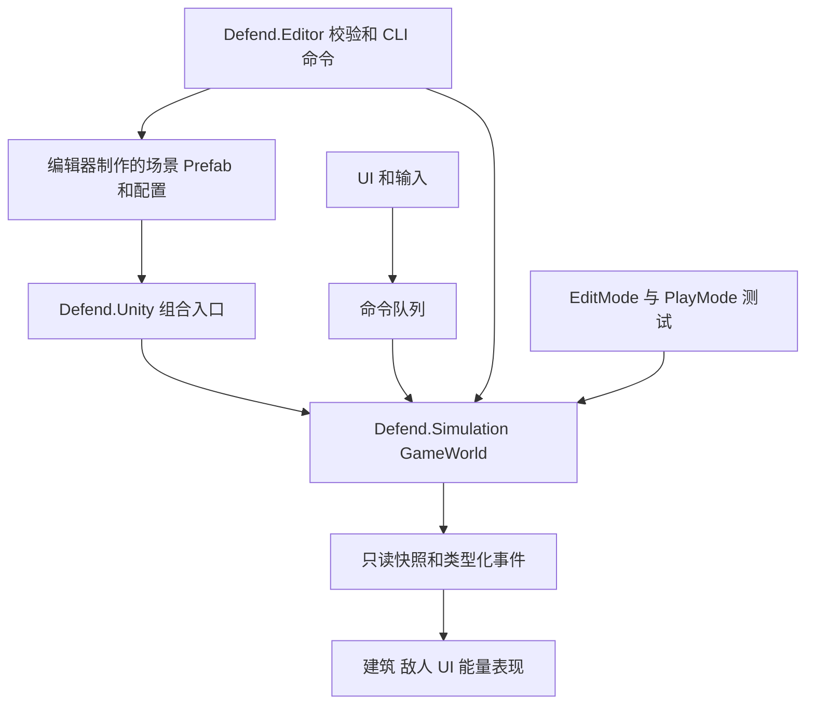

# 涌现防线工程设计

日期：2026-10-10。状态：第二阶段验收已经用户确认结束；第三阶段已在当前工作区扩展。适用工程：Unity 6000.6.5f1。第一阶段接口说明见 `WhiteboxDevelopmentContract.md`，第二阶段实现与工程选择见本文；第三阶段新增规则见 [PhaseThreeGameplay.md](PhaseThreeGameplay.md)，第三阶段证据见 [PhaseThreeReport.md](../Validation/PhaseThreeReport.md)。历史证据见 [第二阶段验证报告](../Validation/PhaseTwoWhiteboxReport.md)。

本设计将已经确认的玩法落实为可分工的模块、数据契约和验证步骤。核心采用纯 C# 模拟，Unity 负责内容制作、输入与表现；能源网络跨波次持续运行，UI 在编辑器中完整制作。能源算法和结算细节见同目录 `EnergyNetwork.md`；项目现状见 `Docs/AI/UnityProjectContext.md`。

## 已确认的产品约束

以下是用户已确认的规则。后文标记为“工程选择”的内容是本轮提出的具体实现，不应误记成用户指定的算法或已经存在的代码。

| 范围 | 规则 |
| --- | --- |
| 能量分配 | 最终用能建筑可设置优先级，按收到的有效能量加权分配；高优先级多分，其他有条件获得供给的建筑也有份额 |
| 本地缓存 | 建筑使用自己的缓冲能量；有缺口就申请补充，扣除已经安排的有效到货量 |
| 自动路线 | 玩家摆放建筑，程序规划路线；优先低损耗，拥堵可走损耗更高的备用路线 |
| 建筑职责 | 反应堆供能；中继储存并转发；炮塔、核心接收并消耗，不将自用缓存退回网络；核心护盾有容量上限，无独立回复速度上限 |
| 中继能力 | 每次输出量和输出间隔限制总吞吐，多个目标共享同一中继的能力 |
| 旧能量 | 可以换目标、改路线；同一批能量不得重复进入已经访问过的建筑 |
| 超时 | 累计断路、持续拥堵等滞留时间；正常飞行和正常输出间隔不计入；恢复运输暂停累计但不清零；拆分、改道、换目标继承预算 |
| 损失边界 | 存活节点中的能量可自救；被毁、出售建筑的内部能量损失；无法完成当前一跳的在途批次消散；不引入游离能量回收 |
| 移动 | 内部缓存随建筑保留，访问历史不清空；移动导致当前传输失效时按上述损失规则处理 |
| 战斗操作 | 玩家可以在战斗期间调整优先级、修复，以及进行已提供的购买、放置、移动、出售操作 |
| 时间和波次 | 能量系统在准备和战斗期间都按模拟时间运行；切换波次不清空、不补满、不重建能源状态 |
| UI | 场景和 Prefab 中可直观手工编辑；禁止在运行时用代码创建 Canvas、面板、按钮或拼装布局来补齐 UI |
| 规模与验收机器 | 选择中型规模：100 栋未出售建筑、200 个同时存活敌人；先在当前 i9-14900HX、RTX 4060 Laptop、32 GB 内存电脑上验收，不由此推定最低配置 |
| 视角与美术 | 战斗镜头相对水平面向下约 70°，保存为 Unity Euler X = 70°，保留正交投影；继续使用白盒美术 |
| 工作方式 | 技术选择需明确告知；实现前有可评审设计，改规则时同步更新设计和对应测试 |

缺能量、断路、吞吐不足时不能承诺所有建筑每个 Tick 都收到能量。份额在持续竞争的一段模拟时间内衡量，有限批次会产生短时误差。

## 本轮工程选择

| 编号 | 选择 | 理由及影响 |
| --- | --- | --- |
| E01 | 纯 C# `Simulation` 与 Unity 表现分离 | 能量、格子、经济、建筑生命周期可独立测试；不靠粒子到达、动画或碰撞回调结算能量 |
| E02 | 单线程、固定逻辑步进，初始试验值 20 Hz | 统一命令、死亡、到货、发送的先后关系。20 Hz 是原型参数，不是已测性能结论 |
| E03 | 逻辑能量用整数定点数，初始 1000 个最小单位等于 1 点能量 | 账目可精确核对；Inspector 仍显示常规能量单位。范围校验与舍入规则见能源设计 |
| E04 | 能量批次和共享访问历史 | 避免每点能量一个对象；保留拆分和改道的防回流约束 |
| E05 | 共享反向 Dijkstra 路径树，历史约束查询使用 A*，加临时拥堵过滤 | 已完成的无约束路径树提供损耗下界，未完成树不作为启发函数；查询仍遵守实际访问历史。缓存按需建立，不预计算所有建筑对 |
| E06 | 按最终有效量计费的加权 DRR | 可处理可变批量、需求封顶和余数；是约束下的加权服务近似，不宣称精确全网加权最大最小公平或最小费用流 |
| E07 | 目标供给预约与下一跳物理空间预约分离 | 防止重复补货、空间超卖；预约本身不计入实际能量 |
| E08 | 稳定建筑 ID、生命代次、位置版本分别记录 | 移动与修复不能洗掉回流历史；旧到货事件不能命中新位置或复活后的实例 |
| E09 | UI 使用编辑器制作的 uGUI Prefab | 项目已有 uGUI；主 HUD、检查面板、商店卡片和状态提示在编辑状态可预览、调整 |
| E10 | 定义用 ScriptableObject，运行状态用普通 C# 数据 | 配置可由策划编辑；进入游戏复制/编译为只读定义，不把当前储能等写回资源 |
| E11 | 先用现有 Unity CLI 与 Pipeline | 已连接现有 Editor；不新增 MCP 桥接包，不为工程设计引入 ECS、DI 容器或网络框架 |
| E12 | 当前一跳在出发时锁定端点位置 | 接收建筑提交移动后，尚未到达旧位置的批次失效。能量不追踪瞬移目标；发送建筑在能量出发后移动不追回能量 |
| E13 | 敌人共用四邻域距离场，按建筑占用版本重建 | 有路就绕建筑去核心；完全封闭时攻击可接近且靠近核心的整栋建筑。属于启发式拆障，不保证最小拆除代价，也不按多格建筑每个占用格重复计算费用 |
| E14 | 敌人可重叠；炮塔即时命中且不检查建筑遮挡 | 先验证能源和战斗闭环，不引入物理拥挤、投射物碰撞或视线系统；这些是公开的白盒简化 |
| E15 | 整笔扣能后射击，缺能等待；五波清场奖励一次，不自动恢复耐久 | 炮塔不积累补射；下一波保留原世界。核心唯一，不能移动或出售，被毁立即失败；具体数值和规则仍可根据试玩调整 |
| E16 | 视图池化，静态状态随逻辑步更新，敌人与能量位置逐帧插值 | 重开归还动态表现，恢复首次启动时记录的手工布局；UI 始终使用场景现有实例 |
| E17 | 全屏背景清除摄像机先绘制，再由局部地图摄像机绘制地图 | 地图外透明文字也获得每帧清除的底色；摄像机保存在场景中，不靠运行时补建 UI |

E12 是已选“依附建筑运输”规则的具体化，会产生玩家可感知的影响：移动有入站能量的建筑可能损失这部分在途能量。移动预览应显示数量，在正式放置前可以取消；拖拽预览本身不修改模拟世界。

E13—E17 是第二阶段已经落地的工程选择。用户确认了开发授权、规模和镜头，具体敌人、炮塔与波次数值属于临时白盒方案，不能改写成用户逐项确认的最终规则。

程序集定义用于限制依赖方向，Prefab 用于保存可复用的组件和层级，ScriptableObject 用于制作共享配置；具体模块划分是本项目的工程选择。[Unity 程序集文档](https://docs.unity3d.com/6000.6/Documentation/Manual/assembly-definition-files.html)、[Prefab 文档](https://docs.unity3d.com/6000.6/Documentation/Manual/Prefabs.html)、[ScriptableObject 文档](https://docs.unity3d.com/6000.6/Documentation/Manual/class-ScriptableObject.html)。

## 模块与依赖



| 程序集 | 责任 | 允许依赖 |
| --- | --- | --- |
| `Defend.Simulation` | 世界、格子、能源、战斗、经济、波次的权威状态与规则 | BCL；不引用 UnityEngine、UnityEditor |
| `Defend.Unity` | CompositionRoot、定义资产转换、输入适配、表现、UI Presenter | Simulation、UnityEngine、Input System、uGUI |
| `Defend.Editor` | 配置/Prefab/场景校验、调试窗口、项目 CLI 命令 | 前两者、UnityEditor、现有 Pipeline |
| `Defend.Simulation.EditModeTests` | 当前纯逻辑行为测试，包括能源、战斗和边界用例 | Simulation；不引用 UnityEngine |
| `Tools/Unity` 验证脚本 | 当前场景引用、Input System 交互、五波流程、重开与压力场景制作 | 通过 Editor 的 `run_script` 执行，不进入 Player |

`Simulation` 设置 `noEngineReferences`；Editor 程序集仅在 Editor 编译。首版不再按每种建筑拆程序集，避免小团队被引用配置拖累。Editor 代码不得落入运行时程序集。

Simulation 内按责任分目录，系统之间通过明确的方法和类型化事件合作，不使用全局字符串事件总线：

| 子模块 | 拥有的状态及职责 |
| --- | --- |
| `World` | 模拟 Tick、命令序号、稳定 ID、随机种子、事件输出 |
| `Grid` | 多格建筑占用、空间邻域、放置合法性、空间版本 |
| `Buildings` | 拥有清单、活跃实例、生命值、移动/出售/修复、配置引用 |
| `Energy` | 连接图、供需、批次、预约、路由、吞吐、滞留、守恒账本 |
| `Combat` | 用能请求、攻击时机、伤害、死亡意图；消耗只通过能源接口 |
| `Enemies` | 目标选择、移动、敌方攻击及道路失效响应 |
| `Economy` | 货币、购买/出售/修复事务；失败命令不扣钱 |
| `Waves` | 波次状态、生成计划、完成条件、奖励；不持有能源容器 |

上述子模块是职责划分。当前经济和建筑命令集中在 `GameWorld`，战斗与波次状态集中在 `BattleSystem`；`Enemies` 目录保存导航和敌人数据，`Waves` 目录保存波次定义。没有为了目录完整而另建一套经济管理器或事件框架。

`GameWorld` 是每局唯一组合入口，显式持有系统；场景中的 `GameSessionRoot` 拥有它。新一局创建新世界；下一波复用同一个世界。重新开始归还动态视图到对象池并恢复初始布局，退出场景才清理表现池。

## 世界命令与逻辑时序

输入只提交意图，例如 `PlaceBuilding`、`MoveBuilding`、`SellBuilding`、`RepairBuilding`、`SetPriority`、`StartWave`。每条命令包含目标 ID、参数和单调命令序号；价格、所有权、占用、存活状态由模拟验证。UI 显示接受或拒绝原因，不直接修改储量、金钱或生命值。

第二阶段实际逻辑顺序如下，对应 `GameWorld.Step`、`BattleSystem.StepCombat`、`EnergySystem.Step` 和 `BattleSystem.CompleteStep`：

1. 按命令序号应用操作，原子更新资源、建筑和格子；撤销的移动预览不生成命令。
2. 仅能源试验模式执行可选测试耗能。战斗模式禁止开启这项负载。
3. 战斗系统先清理过期射击记录，再按稳定建筑顺序结算炮塔射击；随后按稳定敌人顺序移动和攻击仍存活敌人，最后移除死亡敌人。同一步被炮塔击杀的敌人不会再攻击。建筑损毁在生命周期操作中同步失效相关运输，核心被毁立即结束敌方攻击。
4. 能源系统刷新节点与输出机会，先结算已经过去的累计滞留时间，再刷新几何连接图。到达超时阈值的批次先失效，恢复路径不能清零已累计时间。
5. 按到达 Tick、批次身份处理到货，校验生命代次、位置版本和预约；随后采集中继拥堵状态并初始化本步路径工作预算。
6. 执行本步发电，将实际产出存入源头有限缓存；在工作预算内调度、寻路、预约并发送。新发送最早下一逻辑步到达，禁止同一步递归穿过整条链。
7. 更新等待状态，移除已结束批次，生成运输快照与能源状态。
8. 战斗系统按本波间隔和同时存活上限至多生成一个敌人；满员时延后，不积攒一次性爆发生成。没有待生成敌人且场上敌人全部死亡时，先改变波次状态再发一次奖励；第五波结束直接胜利，不自动修复或恢复耐久。

因此，建筑本步被毁时，尚未结算的到货失败；炮塔本步消耗完缓存后，本步到货可供下一步射击使用；本步最后生成的敌人下一步才参与战斗。这是确定性结算选择，不依赖 Unity MonoBehaviour 的 Update 顺序。

时钟由模拟控制，Unity 每帧通过累加器推进整数 Tick。暂停不累计模拟时间，倍速改变 Tick 推进速度。每帧追赶工作设上限，积压保留并记录过载；不能跳过 Tick 后把能量、超时或波次直接快进。正式性能目标需实测后确定。

## 能源与其他玩法的接口

当前调用使用以下实际入口；早期 `Submit`、`EnergyWorld` 等草案名称不再作为工程接口：

```csharp
long GameWorld.Enqueue(WorldCommand command);
void GameWorld.Step();
bool EnergySystem.TryConsume(long buildingId, long amount);
long EnergySystem.ConsumeUpTo(long buildingId, long amount);
EnergyTotals EnergySystem.GetTotals();
void EnergySystem.AssertInvariants();
```

`GameWorld.LastCommandResult` 返回最近已执行命令的结果。构造世界的可选第四参数为 `BattleSettings`；不传时保持能源试验模式，传入后通过 `GameWorld.Battle` 读取敌人、射击、波次与结果。UI 开战调用 `WorldCommand.StartWave()`，由同一命令队列验证。

`TryConsume` 在对应消费规则允许时原子全额扣除自用缓存；炮塔不能先开火后发现能量不足。核心护盾用 `ConsumeUpTo` 原子扣除可吸收的部分，返回实际消费量，再将未吸收伤害作用于 HP。明确消费事件用 `Consumed` 原因记录，不能误记成传输损耗。

第二阶段不采用早期方案中的波末自动恢复建筑与耐久。玩家通过正常维修命令处理损伤：存活建筑维修不补充能量；已毁建筑维修后增加生命代次，以空缓存重新申请能量；售出记录不复活。能源只响应实际建筑变化，不监听“下一波”执行批量清空、补满或创建新网络。

敌人寻路和能源寻路是不同图。能源连线不受建筑遮挡；敌人把建筑占用格视为不可通行区域。所有敌人共享四邻域连通区域和到目标的距离场：能接近核心的区域优先选择核心，否则按阻挡建筑中心到核心的曼哈顿距离选择整栋建筑，同分时按稳定建筑身份排序。当前算法不累计拆除费用，也不把格子 A* 的生命权重冒充最优拆除策略。敌人之间没有碰撞或占格排斥，可以重叠。

修复费用、建造初始储能和五波数值当前采用公开的白盒初值；特殊敌人、物理拥挤、弹道与遮挡尚未实现。炮塔默认射程 7 格、伤害 20、每次耗能 2 点、间隔 8 个逻辑步；敌人默认速度每秒 1.8 格、攻击伤害 8、间隔 20 步。参数位于 `BattleSettingsAsset`，不由能源模块规定最终平衡。

## 目录与场景方案

以下保留长期目录方案。第一阶段已创建 World、Grid、Buildings、Energy，第二阶段已加入 Combat、Enemies、Waves；经济事务仍由 GameWorld 拥有，尚未单独拆出 Economy 目录：

```text
Assets/Defend/
  Scripts/
    Simulation/   World Grid Buildings Energy Combat Enemies Economy Waves
    Unity/        Bootstrap Authoring Input Presentation UI
    Editor/       Validation Diagnostics Cli
  Content/
    Definitions/  Buildings Enemies Waves Energy
    Prefabs/      Buildings Enemies UI VFX
    Scenes/       Game Dev
    Art/          Models Materials Textures Audio
  Tests/
    EditMode/
    PlayMode/
```

第一阶段能源试验入口为 `Assets/Defend/Content/Scenes/Dev/EnergyWhitebox.unity`；第二阶段可玩入口为同目录 `CombatWhitebox.unity`，独立压力入口为 `CombatStress.unity`。场景显式保存 GameSessionRoot、地图、70°战斗摄像机、全屏背景清除摄像机、输入桥、EventSystem 和完整控制面板。背景迁移不会改变第一阶段主镜头的历史视角。后续生产场景 `Game.unity` 仍是规划，不是现有启动入口。

建筑、敌人、能量和射击在游戏中复用已制作的 Prefab 实例；这与禁止运行时创建 UI 是不同范围。`WorldPresentation`、`BattlePresentation` 以身份映射同步已有模拟状态，表现对象不参与命中、伤害或到货结算。建筑与连线随逻辑步或选择变化刷新，敌人与能量位置逐帧插值。

## UI 与预制体制作规范

每种建筑有可直接拖进开发场景检查的 Prefab，建议结构：

```text
BuildingRoot  [BuildingView, Definition 引用, 选择碰撞体]
  VisualRoot  [模型/精灵，可替换美术]
  EnergyPort  [能量表现锚点]
  WeaponRoot  [仅炮塔，包含炮口]
  SelectionRoot
```

权威占地、射程、容量、输出量、间隔来自定义资产，Prefab 不再保存另一份会冲突的数值。表现锚点不会通过运行时 Transform 漂移改变逻辑端口距离。不同职责优先用独立 Prefab 和公共嵌套视觉部件；Variant 只用于职责相同的外观差异，保持浅层继承。Prefab 层级、引用和覆盖应在 Inspector 可查。[Unity Prefab Variant 文档](https://docs.unity3d.com/6000.6/Documentation/Manual/PrefabVariants.html)。

HUD 的完整结构在编辑模式存在：资源栏、波次面板、固定商店卡片、建筑检查面板、优先级控件、移动/修复/出售按钮、暂停面板、提示区域。有限商店和诊断列表使用编辑器预置槽位加分页，运行时切换数据和显隐；不通过 `new GameObject`、`AddComponent`、模板解析或自动兜底生成 UI。将来需要无限动态列表时单独评审，不把运行时 Instantiate UI Prefab 偷当作已获许可。

UI Presenter 从状态读取容量、当前储量、已安排有效到货、优先级和当前状态原因；控件只发命令。实际有效供给率当前由测试和诊断报告核对，不能把预约量当成到货率。建议玩家提示使用“线路中断”“中继拥堵”“等待输出”“接收空间已预约”等具体原因，源码中的账本和数据结构细节不进入玩家界面。

当前 `CombatWhiteboxPanel.prefab` 包含三种可购买建筑、建筑检查与优先级、维修、移动、出售、开始/下一波、暂停、重开与取消放置按钮，显示核心耐久和护盾、波次敌人数及炮塔缺能状态。敌人血条由预制几何构成。没有运行时创建或实例化 UI 控件；重开前后检查 UI 对象身份集合完全一致。背景摄像机覆盖全屏、清除纯色、不渲染物体，渲染顺序早于局部地图镜头。

工程校验包含缺失脚本、空引用、重复定义 ID、非法容量/间隔/权重、Prefab 必需锚点、占地与选择范围不一致、异常覆盖和生产场景缺失 UI。校验失败给出资产路径与字段名，不在 Awake 中补出缺失控件。

能量粒子/线条只表现逻辑批次，可按边和时间窗聚合，限制屏幕上同时显示数量。池化视图归还时重置 ID、订阅、粒子、插值状态；粒子碰撞、播放结束或对象禁用均不能触发权威到货。

## 团队协作与版本管理

建议三个程序职责先分为：模拟与能源、建筑/敌人/战斗、Unity 组合/UI/工具；策划负责定义资产与玩法验收，美术负责视觉子 Prefab 和表现资源。每个功能由一位程序负责接口合入，跨模块变更先改契约和示例。

统一 Unity 6000.6.5f1，提交 `Packages/manifest.json` 与 lock 文件。任何包升级单独提交，记录原因与验证。场景、Prefab 和定义资产连同 `.meta` 一起提交；通过 Unity 工具移动资产保留 GUID，不手工重建引用。序列化字段改名采用迁移措施并实际重开资产验证。

项目已经启用 Force Text 与 Visible Meta Files，`.gitattributes` 已声明 Unity YAML 合并和 LFS。当前机器未查询到 `merge.unityyamlmerge` 驱动配置，不能据此宣称 Smart Merge 已完成部署；本机有 Git LFS，但还需每位成员验证安装、追踪规则和拉取结果。Unity 提供语义合并工具，但无法替代场景负责人和 Prefab 拆分。[Unity Smart Merge 文档](https://docs.unity3d.com/6000.6/Documentation/Manual/SmartMerge.html)。

每个提交限制在一个可评审功能，避免顺手重存无关场景/设置。合并前检查 Console、EditMode、必要的 PlayMode 和资产验证。争用场景通过约定负责人解决，不将二进制资源冲突当文本手工合并。

## CLI 与验证流程

已验证 CLI 1.0.0-beta.8 与 Pipeline 0.8.0-exp.1 可连接本工程。使用现有 Editor 执行工程验证；独立 CI checkout 才使用另起进程的 batch 构建/测试，避免同一工程目录被两个 Editor 占用。[Unity Pipeline 文档](https://docs.unity3d.com/Packages/com.unity.pipeline@0.8/manual/index.html)。

下列只读命令已执行成功：

```powershell
unity --no-banner --json status
unity --no-banner --json command --project-path 'E:\UnityProject\Defend' editor_status
unity --no-banner --json command --project-path 'E:\UnityProject\Defend' console_status
unity --no-banner --json command --project-path 'E:\UnityProject\Defend' get_build_settings
```

实施后的验证顺序为：检查改动范围 → 编译并读取 `recompile_status` → 资产校验 → EditMode → 有 Unity 集成改动时 PlayMode → 需要交付可玩版本时 Windows Development Player。现有 Pipeline 支持 `recompile`、`run_tests`/`test_status`、`build`/`build_status`；调用参数以已安装包文档和 CLI schema 为准，排队成功不等于编译、测试或构建成功。

规划中的项目命令为 `defend_validate_content`、`defend_energy_snapshot`、`defend_energy_audit`。它们目前不存在；自定义命令放 Editor 程序集，正式玩家构建不依赖 CLI。

## 实施顺序与验收

| 阶段 | 交付物 | 进入下一阶段的条件 |
| --- | --- | --- |
| 1 模拟骨架 | 程序集、时钟、稳定 ID、命令队列、建筑/格子状态、只读快照 | 同一输入序列得到相同状态；非法命令不扣资源；无 Unity 类型泄漏进 Simulation |
| 2 能源基础 | 定点账本、生产/消费池、单跳传输、容量预约、到货/销毁结算 | 守恒与容量不变量通过，取消和到货不重复执行 |
| 3 网络调度 | 访问历史、低损耗寻路、加权调度、备用路线、改目标、累计滞留 | 能源用例矩阵通过；复杂瓶颈与资源等待环被覆盖 |
| 4 编辑器资产 | 建筑定义、四类建筑 Prefab、完整手工可编辑 HUD、开发场景 | 编辑器可预览；缺引用校验有效；运行时未拼装 UI |
| 5 动态操作 | 战斗中移动/出售/修复/优先级调整；操作反馈与损失预览 | 同 Tick 边界、旧到货事件、移动新位置、波次连续性集成通过 |
| 6 战斗闭环 | 敌人、攻击、核心护盾、经济与波次 | 波次切换不重置能量；死亡/恢复与能源遵循同一生命周期接口 |
| 7 规模验证 | Development Player、CPU/GC/内存报告、可玩验收 | 达到实测后约定的性能预算；无长时间增长的批次、缓存或历史资源泄漏 |

性能报告需要注明硬件、构建类型、地图、供给量、建筑数、边数、逻辑批次数、改路次数和运行时长。先覆盖 100/400/1600 栋建筑，以及 1000/10000 个活动批次的合成负载；地图占地允许的最大建筑数与批次数不是同一指标。1600 建筑对应约 40×40 地图全部 1×1 的压力场景，不代表实际关卡布局。

初始测量关注能源 Tick 的 p50/p95/最大耗时、稳定运行 GC、拓扑变更尖峰、有效供给比例、滞留消散、缓存命中和批次峰值。没有硬件实测前不承诺 60 FPS，也不以模板工程 Console 无报错替代游戏验证。

## 第一阶段实施说明

本节保留第一阶段历史：当时交付能源网络白盒试验场，没有敌人和完整波次；炮塔、核心通过可关闭测试负载耗能。实际公开接口记录在 `WhiteboxDevelopmentContract.md`。第二阶段已接入真实战斗与波次，不能再把本节的历史范围当成当前状态。

本阶段新增工程选择：

- 使用 .NET `SortedSet` 管理到货顺序及 Dijkstra 待访问集合；共享访问历史由不可变父链表达，不额外实现引用计数池。
- 供应候选和已确定的基础路线跨逻辑步复用，拓扑改变时失效；实际成交前重新核对库存、输出额度和接收空间。无存活批次持有的历史查询取消，仍存活但暂未轮询到的任务不按请求年龄误删。
- 使用 Unity `ObjectPool` 池化能量表现。全部 UI 控件预先保存；运行时只绑定按钮和更新文字。
- 使用已有 Input System、uGUI 和 URP，不安装新框架。中文采用随工程保存的 Noto Sans CJK SC 开源字体，保留 SIL OFL 许可和上游来源，Windows 构建附带许可文本。
- 初始资金、成本、产能和测试消耗是白盒参数，保存于 ScriptableObject。修复暂为即时付费修满耐久；不自动补能。核心测试伤害按 1 点能量抵消 1 点伤害。
- 场景生成器仅首次创建缺失资产，已有场景直接打开，保护开发者的手工修改。构建显式指定开发场景，不替换原模板 Build Settings。

数据与算法正确性、Unity 场景集成、视觉和规模性能分别记录证据；编译通过不能替代后面几项。第一轮密集 100 建筑测量已发现重复寻路开销，后续结果需以完成优化后的同条件测量为准。

## 第二阶段实施与验证边界

当前流程为准备 → 战斗 → 清场奖励 → 下一波，最后一波清场胜利；核心被毁失败，重新开始恢复初始布局。默认五波敌人数为 20/35/55/80/110，生命为 60/75/90/105/120，生成间隔为 10/9/8/7/6 个逻辑步，奖励为 300/400/500/600/800 资金。波末不自动恢复耐久或能量，玩家需要根据压力扩建和维修。这些是可编辑的白盒参数。

能源内部新增中继可用状态局部刷新、历史约束 A*、二叉最小堆、历史前缀复用和临时搜索集合复用。长期额度修复在发生真实发送后按权重推进轮次，保留余额但最多两轮；无发送进展时不累加。几何拓扑变化仍会重建全图，不能把这一版描述成已经完成局部拓扑失效。

Unity EditMode 为 69/69 通过。用户实际运行后关闭程序并确认验证完成，本轮验收结束；最终 100 建筑/200 敌人压力记录为约 22 分 21 秒，守恒差 0。耗时百分位未完成落盘，不把人工结束写成自动跑满 30 分钟；结论见 [PhaseTwoWhiteboxReport.md](../Validation/PhaseTwoWhiteboxReport.md)。纯 .NET 能源对照与长期规则检查见 `Tools/Performance/README.md`，不代表 Unity 帧率；密集 100 建筑仍有超过建议预算的记录，400/1600 建筑存在供给不足，不宣称所有性能目标已经完成。
